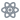

# weasel

A 2D scene-graph engine for React, rendered on WebGL2. Bring your own node data and pose shape; weasel owns the scene tree, the viewport math, pointer and keyboard input, layered rendering, and op-based undo/redo — plus a standard set of editing actions (select, move, resize, rotate, delete, duplicate, nudge, group, align, clipboard, …) bound to the keys and gestures an editor user expects.

Built for diagram editors, sketch tools, schematic editors, scene composers — anything where "objects on a canvas the user can grab, move, and arrange" is the substrate.

## Getting started

[`packages/core/README.md`](./packages/core/README.md) is the guide: installing, mounting `<SceneCanvas>`, the feature presets, actions and how to tune or replace them, text, custom shaders, and core's subpath imports. It is also the README on npm and the site's "Get started" page.

## Demo

<https://orochi235.github.io/weasel/> — every kit feature as a small runnable demo, plus the release history for every published version.

## Packages

Every package is published under `@weasel-js` and released together at one version. `npm run check:needs` holds the marks to the code.

<!-- packages:start -->

 needs React ·  React only under `/react` ·  needs a browser; the rest run in Node or a worker ·  WebGL2 ·  Web Audio ·  no other weasel package

| Package | | What it is |
|---|---|---|
| `core` |  | the scene graph, `<SceneCanvas>`, actions, and tools |
| `headless` |  | `renderSceneToPixels` from Node: a headless Chromium page holding one raster session, scenes in as JSON and pixels out |
| `geom` |  | pure geometry — 2D affine, box, curve, polyline; polygon booleans under `./booleans`; 3D vectors, quaternions, matrices and rays under `./3d` |
| `gestures` |  | the gesture taxonomy, route grammars and matchers |
| `history` |  | undo/redo with scoped sub-histories |
| `routing` |  | binding-to-action routing: the gesture dispatcher, the action registry, tool and contribution declaration |
| `select` |  | selection as a value: which ids a press selects, with toggle, range and anchor rules |
| `ui-input` |  | what a key or a pointer does to a control, as pure functions: steps, sliders, list roving and typeahead, selection, reorder |
| `ui-logic` |  | what a DOM component and a canvas-drawn widget share past their drawing: the measure/draw contract and a focus scope |
| `menu` |  | the headless model behind context menus: entries, a controller for highlight, submenus, keyboard and typeahead, and placement |
| `registry` |  | keyed registries you can enumerate and subscribe to |
| `icons` |  | namespaced icon names and the icon registry; no React, no DOM, no glyphs of its own |
| `icons-plugin` |  | the build plugin that ships only the glyphs a build names, for vite, rollup, rolldown and esbuild |
| `react` |  | generic React hooks the other packages share: `useLatest`, `useStableByContent`, `useVisibleRaf` |
| `paint` |  | fills, strokes, gradients and dashes as plain data |
| `stroke` |  | a stroke as geometry: the ribbon mesh, the marker registry, and a stroke outlined as a path |
| `renderer` |  | the WebGL2 renderer: draw commands, batched fills and strokes, text, images, gradients, patterns, shader programs, and effects |
| `pdf` |  | PDF documents from draw commands, with selectable embedded text, and regions of a scene written as one |
| `dither` |  | pixels to 1-bit ink: four ditherers for an export, and threshold and Bayer as a live effect on a printer's dot grid |
| `p-touch` |  | Brother P-touch labels from a scene: `.lbx` files, and printing over WebUSB or Web Serial |
| `plot` |  | scales, axes, and marks, and charts built from them that edit by dragging their values |
| `text` |  | styled runs, kerned layout, wrapping and measurement |
| `text-dom` |  | in-place text editing: a contenteditable overlay that reads and writes styled runs |
| `bidi` |  | the Unicode Bidirectional Algorithm (UAX #9) |
| `text-shaping` |  | OpenType shaping through HarfBuzz: joined Arabic, Indic conjuncts and reordering, mark placement, ligatures and a face's own small caps |
| `font` |  | MSDF atlases, glyph metrics and runtime glyph rasterization |
| `quantity` |  | numbers with units and a display, as text, spoken text, HTML and MathML |
| `simulation` |  | an N-body integrator that takes d3-force's forces, and a hook that runs it on a frame loop |
| `svg` |  | SVG import and export |
| `modes` |  | app-level modality: capability tags, mode definitions, a mode registry |
| `storage` |  | keyed async storage behind one adapter interface: IndexedDB, localStorage, the URL hash, memory |
| `prefs` |  | a preferences schema, a store that validates, migrates and persists against it, and React hooks over the store |
| `diagram` |  | node-link diagrams: ports on any node's perimeter, flowchart-style bodies |
| `diagram-elk` |  | an ELK layout adapter: lays a diagram out once with elkjs, ports, labels and nested groups included |
| `diagram-formats` |  | diagrams to files: one page as an SVG document or a PNG image |
| `guides` |  | placement aids: grids, guide lines, alignment and snapping to them, container layout strategies |
| `editor` |  | an editor app's session, file and page glue: autosave and restore, snapshots, open and save, pages and their fit, the paper and grid |
| `hud` |  | WebGL-rendered widgets composited into a canvas |
| `animator` |  | tweens, springs, holds, staggers and timelines that combine on targets, on one frame loop; no scene |
| `parallax` |  | parallax planes and tiled surfaces: layers that draw other layers through a derived view |
| `minimap` |  | a minimap with linked cursors: an overview you press and drag to move the main camera, on the canvas's own surface or one of its own |
| `kernel3d` |  | poses, an orbit camera, ray picking and screen-projected chrome over core's scene graph; hosts a renderer |
| `symmetry` |  | live symmetry groups: a container whose mirrored, rotated and repeated copies are drawn from its real children, so every edit reaches every copy |
| `path-tools` |  | path-editing tools as presets an app opts into: brushes, bridge, trim and extend, curvature and handle balance, path constraints, path effects, and warps |
| `rig` |  | rigging tools: the bone tool, which draws and edits a node's skeleton, and the weight tool, which paints how much each joint moves the paths under it |
| `cursor` |  | tool cursors as authored glyphs, baked to CSS or painted when too large |
| `loupe` |  | a magnifier model: where it's aimed, how far it magnifies, what's under it |
| `brush` |  | brushes for tools: one size shared across the tools that link to it |
| `audio` |  | a Web Audio engine: voices, buses, lookahead scheduling, spatialization |
| `clock` |  | a run of time: a position moved by a signed rate, with passes, ramps, seeking and one frame loop for many clocks |
| `d3` |  | d3 data-join and transitions over `useScene` |
| `theme` |  | design tokens as CSS variables and a parallel TypeScript export |
| `ui` |  | React chrome components for weasel apps |
| `devtools` |  | a panel that reads and steers every canvas on a page: its scene tree, state, dispatch trace and frame cost |
| `labkit` |  | React widgets for self-contained interactive lab pages |
| `forge` |  | a component workshop on labkit: stories in isolated frames, controls and state in lab trials |

<!-- packages:end -->

## Documentation

- [Concepts](./docs/concepts.md)
- [Hooks](./docs/hooks.md)
- [Adapters](./docs/adapters.md)
- [Extending](./docs/extending.md)
- [Scene serialization](./docs/scene-serialization.md)

## License

MIT.
