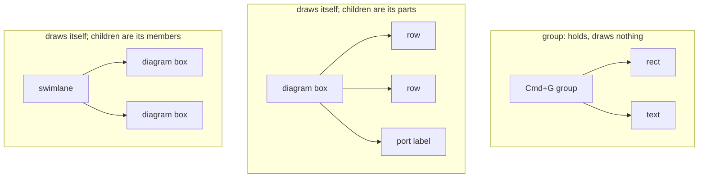
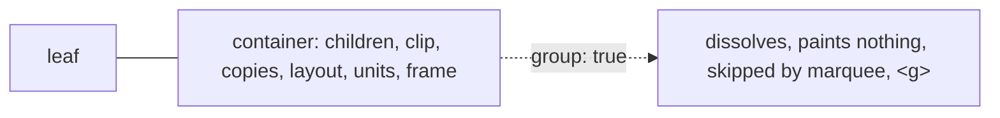
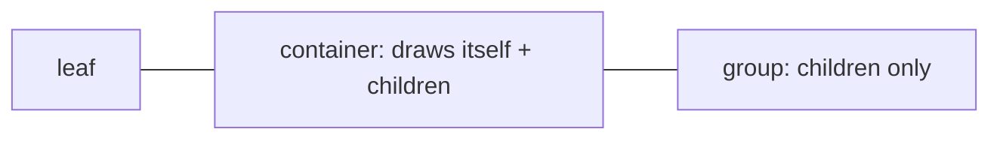
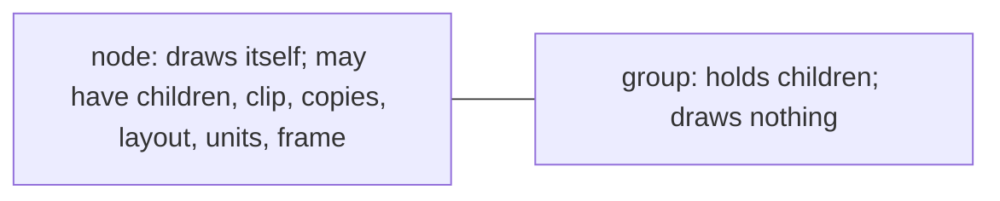
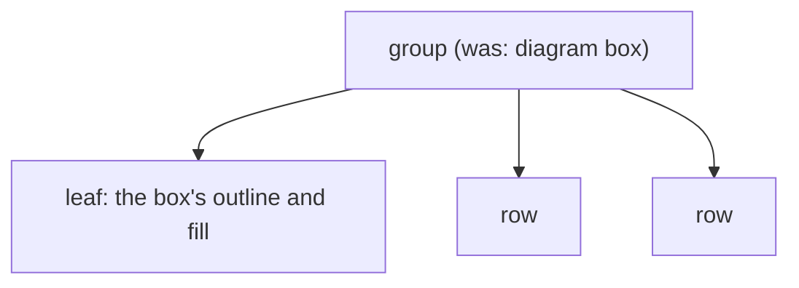

# Groups, and nodes that have children

**A decision request, unbuilt (2026-10-22).** For the maintainer. Core has one node kind that can hold
children, `container`, and the code uses it for two different things: a **group** (Cmd+G, SVG `<g>`),
which exists only to hold its children, and a **node that draws itself and has children** (a diagram
box and its rows, a skeleton bone and its child bones). This document lays out the ways to tell them
apart and what each one costs. Nothing here is built. Every claim about the code cites where it was
read; anything inferred says so.

## What exists today

Core has two kinds (`core/scene/types.ts`): `leaf`, with no children, and `container`, with an
ordered `children` list. The doc comment on `ContainerNode` calls it "the real group: what Cmd+G
creates, what SVG `<g>` round-trips to", and `docs/taxonomy.md` ("Group vs Selection") says the same.
These are the producers of `container` outside tests:

| Producer | What it is |
|---|---|
| Cmd+G (`interactions/actions/defaults/group.ts`) | group: an envelope (its box is its children's union) under absolute poses, a frame under composed ones |
| SVG `<g>` (`svg/unpack.ts`, draw's `openSvg.ts` / `svgInterop.ts`) | group, with `data.path` as its clip and its fill held only for children that `'inherit'` it |
| draw's outlines (`apps/draw/src/outlinesAdapter.ts`) | group (envelope) that carries the source's data |
| symmetry (`symmetry/src/group.ts`, `bake.ts`) | group that paints copies of its subtree (`copiesFromPose`) |
| Parallax, RigTools demos | group (a clipped or unclipped frame) |
| diagram body (`diagram/src/buildBody.ts`) | **draws itself**; its rows and port labels are parts (`pickable: false`) |
| diagram region: container, pool, lane (`diagram/src/containers/regionSpecs.ts`) | **draws itself** (fill, stroke, header); its children are **members** dragged in and out, laid out by `layout` |
| MoveSnap demo bins | **draws itself**, a drop target |
| platformer bones (`apps/site/demos/platformer/sceneWorld.ts`) | **draws itself**; child bones hang off it in its frame |

Diagram *groups* are not containers at all: `diagram/src/dataGroups.ts` emits a `leaf` whose pose
derives from its members through `dependsOn`.

So a node with children comes in three shapes, which every option has to place:

## What the kind decides today

These behaviors branch on `kind === 'container'`, and the column says which of the three shapes each
one is actually right for:

| Behavior (where) | Today, for every container | Right for |
|---|---|---|
| Ungroup dissolves it (`group.ts:146`) | yes | group only. Ungrouping a diagram box or a symmetry group scatters it (inferred from the code; not run). |
| Paints its own fill (`shapePainter`, `pathPainter`, `rectFallbackPainter`) | `kit:path` paints nothing, `rectFallback` skips it, `kit:shape` and `diagram:outline` paint | group: never. Others: always. |
| Clips its children (`buildSceneTree.ts:128`) | to `clipFromPose`, else to its painter's silhouette, which is why `clipNothing` exists | all three, opt-in |
| Paints copies of its subtree (`copiesFromPose`) | container-only field | group (symmetry) |
| Lays out its children (`layout`) | container-only field | members (lanes) |
| Unit scope for its children (`units`) | container-only field | any |
| Frame for children's poses (`definesFrame`, composed strategies) | unless it is an envelope | any |
| Drop target (`move/commit/reparent.ts:47`) | yes, if the session admits it | group, members |
| Source for a child's `'inherit'` (`inheritedPaint.ts:46`) | yes | group (SVG `<g fill>`); arguably any |
| Marquee and lasso skip it (`hitTestArea.ts:47`) | yes | group |
| Drawn bounds come from its children only (`drawnBounds.ts:78`) | yes, so a diagram box's own stroke is ignored once it has rows | group only |
| Property panel routes it as `'group'` (`defaultNodeRouting.ts:11`) | yes, so a diagram box gets group properties | group only |
| SVG export writes `<g>` with no shape (`svg/fromKit.ts:265`) | yes; diagram-formats puts the outline back itself (`pageNodes.ts:135`) | group only |

Every "group only" row is wrong today for diagram boxes, regions and bones. The fill row was made
worse by the container-inherit arc: `kit:shape` skipped containers, so every platformer bone with
children drew nothing, until `cbb16cab7` (2026-10-22) put it back for `kit:shape` alone.

## The options

### A. A group is declared on the container

`kind: 'container'` keeps meaning "has children"; a container that is a group says so (`group: true`).

### B1. Three kinds

`leaf`, `container` (draws itself, has children) and `group`. The container-only fields go on both
`container` and `group`.

### B2. Drop `container`; any node can have children, and `group` is the one special kind

`children` moves onto every node (optional, absent until it has one), and so do clip, copies, layout,
units and frame. A diagram box is an ordinary node with children. `group` is a node that draws nothing
and exists to hold them. The name of the ordinary kind is open: `leaf` is wrong once it can have
children.

### B3. Drop `container`; only groups have children

A node that draws itself and has parts becomes a group holding a leaf for its own drawing plus the
parts.

## What each option costs

| | A: declared group | B1: three kinds | B2: children on any node | B3: only groups have children |
|---|---|---|---|---|
| **Kinds** | `leaf`, `container` + flag | `leaf`, `container`, `group` | ordinary, `group` | `leaf`, `group` |
| **A diagram box is** | a container without the flag | a `container` | an ordinary node with children | a group of an outline leaf and its rows |
| **Ungroup on a diagram box** | refused | refused | refused | dissolves it, unless groups gain a "can't be dissolved" flag, which is A again |
| **Saved scenes** (`serialization.ts` accepts only `version: 1`) | v1 Cmd+G and SVG groups lack the flag; a v1 load must mark them | v1 `container` has to become `group` or stay `container` on load | v1 `container` has to become `group` or an ordinary node with children; a version 2 | v1 diagram boxes would need restructuring into two nodes; a version 2 |
| **How a v1 load decides** | see "Migration" below; the same question in every option | same | same | same, plus a tree rewrite |
| **Public types** (`ContainerNode`, `LeafNode`, `SceneNode`, `AddNodeSpec` from `@weasel-js/core`) | additive | `GroupNode` added; `ContainerNode` changes meaning | `ContainerNode` removed, `LeafNode` renamed or widened; breaking | `ContainerNode` renamed; breaking |
| **Sites to touch** (`kind === 'container'` and literals, outside tests: core 66, diagram 10, symmetry 6, svg 5, draw 5, site 5, devtools 3, diagram-formats 2) | the "group only" rows above, maybe 15 | every site, to choose container or group | every site; about 15 narrow only to read `children` and become "has children" | every site, plus diagram's builders |
| **TypeScript** | narrowing unchanged | three-way narrowing | can't prove a node has no subtree; `children` is optional everywhere | narrowing unchanged |
| **Container-only fields** (`nodeFnFields.ts` drops a write to a leaf) | stay on `container` | on both | on every node | on `group` |
| **Clip default** (a container with no `clipFromPose` clips to its painter's silhouette) | unchanged, `clipNothing` still needed | unchanged | has to be decided for every node with children; "no clip unless asked" would retire `clipNothing` | groups have no painter, so no clip by default |
| **Picking a part** | unchanged (`pickable: false` on rows) | unchanged | unchanged | the outline leaf is a sibling of the rows, so a click picks the leaf, not the box, unless the group is the pick target |
| **Where a diagram box's data lives** | on the container | on the container | on the node | split between group and outline leaf |
| **SVG export** | flag picks `<g>` vs a shape followed by its children | kind picks it | kind picks it; diagram-formats' workaround goes | a group is always `<g>`; works |
| **Matches the rule "inherited behavior is declared"** | yes, on the flag | yes, on the kind | yes, on the kind | yes |

### Migration

Every option has to classify saved containers. From the code:

- draw saves scenes to localStorage (`apps/draw/src/sceneLoading.ts`, key `weaseldraw:scene-v1`), and
  every container it can make is a group (Cmd+G, SVG `<g>`, outlines, symmetry).
- Diagram scenes are built from diagram data by `diagramScene` / `fromData`; the read found no diagram
  scene being persisted as a scene (inferred: nothing in the repo saves one).
- The demos build their scenes in code.

So "a v1 `container` loads as a group" is right for everything this repo saves. A consumer who saves
diagram scenes, or scenes with self-drawing containers, would need to say otherwise; the loader would
take an optional classifier for that. draw already has a migration step for node data
(`apps/draw/src/persistence.ts`, `migrateLegacyPaint`); core has no migration hook, only the strict
`version === 1` check, and history (`SCENE_HISTORY_FORM`) is dropped rather than migrated on a
mismatch.

## Already broken, whichever option is chosen

Found while reading for this; none of these depend on the decision, and each is a TODO candidate:

- **Draw drops fields on reload.** `apps/shared/editor/src/snapshot.ts` restores no `clipFromPoseKey`
  (its own comment says so) and never reads `copiesFromPoseKey` or `units`, so a symmetry group
  loses its copies and its `clipNothing` across a reload (inferred; not run).
- **kernel3d sees a container as a cube.** It boxes every node from its own pose and never reads
  children (`kernel3d/src/pickIndex.ts`, `world.ts`). Harmless while 3D scenes hold no containers.

## My read

B2 is the one where the scene's shape says what each node is. A node's children are a structural
fact any node can have, and only `group` carries behavior of its own. Its cost is breadth, not risk:
every site that reads `kind` changes, and the public types break. But the migration is the same
"v1 containers load as groups" that every option needs. B3 rebuilds the conflation one level down.
A is the smallest change and leaves `container` meaning only "has children".

## What you decide

1. **Which option:** B2 (2026-10-22). Whether a node draws itself is its kind: a group draws nothing,
   and every other node draws itself. Having children is not a kind; any node may.
2. **The ordinary kind's name:** `mark` (2026-10-22), so a node is `kind: 'mark' | 'group'`. Not
   `leaf`: "leaf" means a node with no children and nothing else, so it becomes a fact read from the
   tree (`isLeaf`), never a kind (2026-10-22). Other names already say "mark" — diagram's `DataMark`
   (what a data node draws besides its rows), snap's `SnapMark`, path editing's `PathEditMark` — and
   the node kind's type takes the bare name, `MarkNode`.
3. **A child's `'inherit'` reads its parent, whatever kind** (2026-10-22): the parent's paint if it
   has one, the parent's own source if the parent also says `'inherit'`, and none if the parent has
   none. The child's `'inherit'` is the declaration, so the source needs no rule of its own.
4. **No clip unless declared** (2026-10-22): a node with children and no `clipFromPose` clips nothing.
