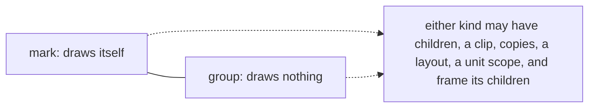
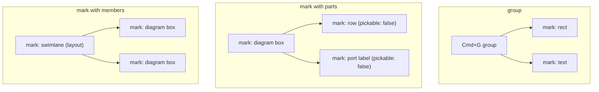

# Groups and marks

**Design, unbuilt (2026-10-22).** For whoever builds it. Core's scene has one node kind that holds
children, `container`, and uses it for two different things: a **group** (Cmd+G, SVG `<g>`), which
exists only to hold its children and draws nothing, and a node that **draws itself and has
children** (a diagram box and its rows, a swimlane and its members, a skeleton bone and its child
bones). This replaces `leaf | container` with `mark | group` and makes having children a property of
any node. The decisions below are the maintainer's; "left to the builder" marks what is not.

## Decisions

All 2026-10-22.

1. **A node's kind says whether it draws itself.** `kind: 'mark' | 'group'`. A mark draws itself
   through its painter; a group draws nothing of its own.
2. **Having children is not a kind.** Any node may have children. `container` is removed.
3. **"Leaf" means a node with no children, and nothing else.** It is read from the tree
   (`isLeaf(node)`), never stored as a kind.
4. **A child's `'inherit'` fill or stroke reads its parent, whatever the parent's kind:** the parent's
   paint if it has one, the parent's own source if it also says `'inherit'`, and none if it has none.
5. **A node clips its children only when it declares a clip.** No clip is the default.
6. **A group is selected and behaves as one item.** A press on any member of a group selects the
   group, the outermost one when groups nest, and it moves, transforms, copies and deletes as one.
   This holds for every group: Cmd+G, SVG `<g>`, symmetry, draw's outlines.
7. **Two ways in to a member:** double-click a group's member to enter that group, after which a
   press selects among its children and a further double-click goes one level deeper; Cmd-click
   (Ctrl-click off macOS) selects the deepest pickable node under the pointer directly. Inside an
   entered group, double-click on a member that is not a group does what it does today (text edit,
   path edit, through `doubleClickTarget.ts`). Cmd-click stops extending the selection, which today
   it does as Shift does (`pressDecision.ts`, `isExtend = mods.shift || mods.meta`); Shift alone
   extends.

Rejected (2026-10-22), so nobody re-proposes them: a `group: true` flag on `container` (keeps
"container" meaning only "has children"); three kinds `leaf | container | group` (keeps a second split
on having children); only groups have children, with a self-drawing node rebuilt as a group of an
outline leaf and its parts (rebuilds the same conflation one level down, and ungroup takes it apart).

## The model

The three shapes the code has, placed:

Parts and members differ only in what is already per-node: `pickable`, and whether the parent
admits drops.

## What the kind decides, and what children decide

Every branch on `kind === 'container'` today goes to one of these columns. The second column is
"has children", read from the tree.

| Behavior (where today) | Decided by | Rule |
|---|---|---|
| Ungroup dissolves it (`interactions/actions/defaults/group.ts`) | kind | groups only. A mark is never dissolved. |
| Cmd+G creates it (`group.ts`) | kind | creates a group |
| Paints its own fill and stroke (`shapePainter`, `pathPainter`, `rectFallbackPainter`, `diagram:outline`) | kind | a group never paints, whatever its data; a mark paints through its painter. No painter checks kind any more; the walk doesn't call a painter for a group. |
| Its own interior is hit (`NodeShape.ts`, `CONTAINER_INK` in `nodePaint.ts`, `adapterPointQuery.ts`, `ownClipOf` in `pickWalk.ts`) | kind | a group is hit through its members, and anywhere in its box, as an unclipped container is today. A mark is hit by its painter's ink; a painter with no `ink` counts as filled, which keeps an unfilled diagram lane hittable across its interior (`diagram:outline` has none). |
| Which node a press selects (`pickTopMostHit`, `pressDecision.ts`, the select tool) | kind | the outermost group above the hit node that is not the entered group or above it (decision 6); a mark is selected itself, and so is a mark's part only when the part is pickable |
| Entering a group (new) | kind | double-click on a group's member enters it (decision 7). The entered group is session state beside the selection, not scene data and not undoable. Escape, or a press outside it, leaves it one level. |
| Marquee and lasso skip it (`canvas/deps/hitTestArea.ts`, `includeContainers`) | kind | groups skipped by default (rename the option to say groups) |
| Drawn bounds (`drawnBounds.ts`) | kind | a group's are its children's; a mark's are its own ink united with its children's |
| Property panel route (`defaultNodeRouting.ts`, `name: 'group'`) | kind | groups only |
| SVG export (`svg/fromKit.ts`, diagram-formats `pageNodes.ts` workaround) | kind | a group is a `<g>`; a mark with children is a `<g>` holding its own element and then its children's. diagram-formats' outline workaround goes. |
| Status bar group count (`apps/draw/src/EditorStatusBar.tsx`) | kind | counts groups |
| Reads `children` (about 15 sites in core: `treeReads`, `nodeStore`, `renderOrder`, `treeOrder`, `treeEdits`, `kitOps`, `staleReplay`, `sceneClipboard`, `devtools/handlers`) | children | any node |
| Clip (`clipFromPose`), copies (`copiesFromPose`), layout, unit scope | children | any node; `nodeFnFields.ts`' `containersOnly` guard goes |
| Frame for children's poses (`definesFrame`) | children | unchanged: any node that is not an envelope |
| Drop target (`move/commit/reparent.ts`, `insert/parent.ts`, `admitsOf` in `move/session.ts`) | kind | with no `canDropInto` dep, a group admits and a mark does not, which is today's behavior (only containers took drops). A mark takes children by drop or `insertInto` only when `canDropInto` says so, as diagram's regions do. |
| `'inherit'` source (`inheritedPaint.ts`) | neither | any parent (decision 4) |
| "A container outlives its children" (`types.ts`) | kind | a group outlives them; a mark is a mark with or without |
| `treeEdits` throwing "is not a container" | neither | goes; any node can take a child |

The existing `kind === 'leaf'` checks mostly mean "a content or path node" (path-tools, booleans,
minimap, d3, diagram-formats, draw's text editing). Each becomes `kind === 'mark'`, or `isLeaf` where
it truly means "no children"; the builder reads each one.

## Clips

`clipFromPose(pose)` receives only the pose, so it cannot say "clip to my own outline", which is what
an SVG `<g clip-path>` needs: import stores the clip path in the group's `data.path` and relies today
on the default clip-to-silhouette. Add a declared, serializable form of that: a node field saying
"clip my children to my own outline", read from the node's painter silhouette, or from `data.path`
for a group, which has no painter. Its name and exact shape are left to the builder.
`clipNothing` (and `CLIP_NOTHING`) retire from use but stay registered, so saved scenes that name
them still load. The platformer's `clipFromPose: () => null` and diagram's `clipNothing` go.

## Saving and loading

`serialization.ts` accepts only `version: 1`, and `SerializedNode.kind` is `'leaf' | 'container'`.

- Write `version: 2`, with `kind: 'mark' | 'group'`.
- Load version 1 by mapping `leaf` to `mark`, and `container` to `group`, unless the caller passes
  a classifier that says otherwise. Every container this repo saves is a group: draw's (Cmd+G, SVG,
  outlines, symmetry). Diagram scenes are rebuilt from diagram data, and the demos build in code
  (inferred from reading; nothing in the repo was found saving either as a scene).
- A version 1 container that drew itself would load as a group and draw nothing; the classifier is
  how a consumer prevents that, and the changeset says so.
- Scene history (`SCENE_HISTORY_FORM`) is dropped on a form mismatch, as today. Bump it.
- Draw's loader (`apps/shared/editor/src/snapshot.ts`) restores no `clipFromPoseKey` and never reads
  `copiesFromPoseKey` or `units`. Fix it in this work: after decision 5, an SVG clip group that loses
  its declared clip on reload is visibly wrong, and symmetry groups already lose their copies.

## Public API

Breaking, said in the changeset prose.

- `LeafNode`, `ContainerNode` → `MarkNode`, `GroupNode`, both with optional `children` and the
  fields `ContainerNode` carried. `SceneNode` stays the union.
- `AddNodeSpec.kind: 'mark' | 'group'`, and `parent` accepts any node.
- `isLeaf(node)` and `hasChildren(node)` exported. `children` stays absent until a node has one, so a
  scene of marks allocates no arrays.
- diagram's `BodyNodeSpec.kind` follows.
- `docs/taxonomy.md` ("Group vs Selection") and the `ContainerNode` doc comment are rewritten.

## Every producer, and what it becomes

| Producer | Becomes |
|---|---|
| Cmd+G (`group.ts`), draw outlines (`outlinesAdapter.ts`), SVG `<g>` and its root wrapper (`svg/unpack.ts`, draw `openSvg.ts` / `svgInterop.ts`), symmetry (`symmetry/src/group.ts`, `bake.ts`), Parallax and RigTools demos | group |
| diagram body (`buildBody.ts`), diagram regions (`containers/regionSpecs.ts`), MoveSnap bins, platformer bones (`sceneWorld.ts`) | mark with children |
| every other `kind: 'leaf'` producer, kernel3d's included | mark |
| loaders and copiers that pass `kind` through (`serialization.ts`, draw `snapshot.ts`, `sceneClipboard.ts`, `copySubtree.ts`, `kitOps.ts`, `treeEdits.ts`) | pass the new kinds through; version 1 mapped on load |

kernel3d reads a flat render order and boxes each node from its own pose; it never reads children
(`kernel3d/src/pickIndex.ts`, `world.ts`). It needs only the kind rename.

## Goals and anti-goals

- **Goal:** every behavior that today branches on `container` lands in the right column above, and a
  diagram box, swimlane or bone behaves as a mark: it paints, is hit by its own ink, is never
  dissolved by Ungroup, and routes as itself in the property panel.
- **Anti-goal:** a mark's behavior changing because it gained or lost a child, beyond the "children"
  column. A box with no rows and a box with rows are the same kind of thing.
- **Goal:** a group behaves as one item until it is entered, everywhere a node can be pressed:
  canvas, and the press half of every tool that selects.
- **Anti-goal:** a second notion of "group" anywhere (a flag, a data field, a routing name that
  disagrees with the kind).
- **Non-goal:** 3D containers in kernel3d.

## Calls made after the builder check

These keep today's behavior; the maintainer can overturn any of them (2026-10-22):

- An unfilled diagram lane stays hittable across its interior, through `diagram:outline`'s default ink.
- Without `canDropInto`, only groups take drops.

## Left to the builder

- Where the entered group lives (a selection-adjacent store or dep), how it is shown (a frame or
  dimming outside it), and whether the layers panel selects members directly (it should: a row is
  already one node).

- The declared outline clip's field name and shape.
- The classifier's signature on the version 1 loader.
- How to split the work into arcs. One natural order: core types, serialization and the version 1
  load; then the behaviors table; then clips and draw's loader; then the producers in diagram,
  symmetry, svg and the apps. The whole repo must typecheck at each merge, so the first arc may have
  to carry the rename through every package.
- Each `kind === 'leaf'` site's reading: mark, or no children.
