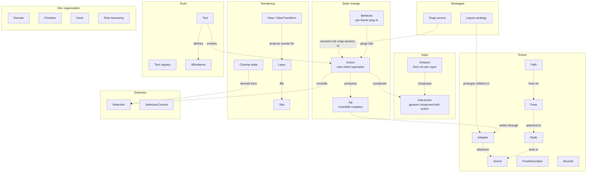

# Weasel Taxonomy

A single source of truth for the kit's terminology, organized by concept-family.

This doc is **meta-structure**: what the abstractions *are* and how they relate.
Per-symbol details (function signatures, options, examples) live in JSDoc and the
API reference.

## Conceptual map

Each box is a *domain* — a subsystem with its own vocabulary. Each entry is a
concept in that domain. Arrows show cross-domain relationships.

---

## 1. Consumer-side abstractions

The vocabulary an app developer uses to wire up the kit.

### Contribution

A registry entry: what it contributes, and when it is eligible. Every role is
optional and independent — `bindings` (its entire input surface), `actions`,
`deps` (live sources its actions read, installed while it is), an `overlay`
layer, `presentation` for a palette. An entry that only routes input declares
only the first two. See `packages/routing/src/contributions/types.ts`.

**`SurfaceContribution`** is the canvas's form, and the kit's unit for shipping
a feature: it adds `views` (cameras over rects of the surface), `attach`
(runs against the mounted canvas, returns its teardown, for what the other
roles cannot say), `beforePaint` / `afterPaint` (run on the surface's frame
loop) and `requires` (the kit versions it was written against). `<SceneCanvas ambient>` installs every role an entry
declares and removes them with it; `mergeContributions` concatenates features
and throws on a duplicate entry id, dep name or view id. The minimap
(`@weasel-js/minimap`) and the HUD (`useHudContribution(hud)`) are built this
way. `docs/extending.md` has the full map. See
`packages/core/src/canvas/surfaceContribution.ts`.

**Eligibility** is a *set* of conditions, not one value, because one entry holds
several at once — the hand tool is palette-selectable and space-held:

- `focus` — selectable as the focused entry; exclusive, one at a time.
- `offhand: HotkeyTrigger` — also live while that key is held: a modifier,
  `'space'`, or any other key (`'o'`), matched case-insensitively. The key
  engages it only between gestures; mid-gesture it belongs to the gesture's
  own tool (Space repositions a shape being drawn).
- `always` — live regardless of what is focused.
- `claimed` — live only for input this entry's own affordances produced.
- `capabilities` — modality filter, applied wherever it would otherwise be live.
- `keymap` — live only while it is the innermost [keymap](#keymap-and-leader) open,
  at the hotkey tier.

The scope tier a binding matches at is *derived* from whichever condition is
live (`liveScope`), ordered to match the dispatcher's own hotkey > active >
ambient walk. So an entry lands in a tier because of what it declares about
itself, not because of which argument a consumer passed it in.

### Tool

A `Tool` is the **focus-declaring case** of a Contribution: it adds
the fields that only mean something for a mode the user switches into —
`onActivate`/`onDeactivate`, a `cursor`. A tool publishes no
preview of its own: what a gesture proposes comes from the in-flight action's
handle (see [Gesture overlay](#gesture-overlay)). The lifecycle pair brackets the time a tool is
*live* — in the active slot, held by its `hotkey`, or both — and takes no
argument: a tool that keeps state between gestures closes over it. Distinct from [Gesture hooks](#gesture) in that a
Tool is a stateful mode while a gesture hook is a direct binding to a pointer
interaction. See `packages/routing/src/tools/types.ts`.

Not every entry is a Tool. `@weasel-js/hud` contributes bindings and actions and
declares `claimed`; it has no lifecycle, no palette icon, and nothing to preview.
`isTool(entry)` is the test — `focus` or `offhand` eligibility — and the focus
hooks run only for entries it passes. So "tool" names only what a user picks from
a palette or holds on a key. Anything that holds every kind of entry takes
`Contribution` and says "entry": `<SceneCanvas ambient>`, `useTools`'s `ambient`,
the dispatcher's `entriesById`, and `ownerId` on a scoped binding, a route-registry
row and a dispatch record.

The **select tool** is a Tool in this sense and only chooses: `select.pick` on
press, the deferred multi-click collapse on release, `areaSelect` on an empty
drag, `clearSelection` on an empty click. Acting on the selection is not the
select tool's. Moving, cloning, resizing and rotating it are `always` entries
owned by the selection (`selectionMoveContribution`,
`selectionResizeContribution`, `selectionRotateContribution` in
`tools/builtin/select`), so they are live
under any tool that leaves the gesture unclaimed.

A rail holds tools and **commands**. A command takes a rail slot and runs once
when pressed; it holds no focus and binds no input, so it is not a Tool and
`isTool` never sees it. labkit's `CommandItem` is one beside its `ToolItem`,
and forge's Info button is a command on the workshop's rail.

Nothing is a base tool. A bare `<SceneCanvas>` registers no tool and has none
active; the `select` preset (or `pick`, which adds the selection outline)
registers select and makes it the initial active tool and Escape's return
target, and without it Escape returns nowhere. The presets `<SceneCanvas
features>` takes are listed in `docs/concepts.md`.

### Affordance

A reusable factory primitive that produces a `{ id, render, hitTest? }` triple consumed by tools. Lives in `packages/core/src/affordances/`. Tools compose multiple affordances into a single overlay layer via `composeAffordanceLayer`. The dispatcher consults each composite layer's `hitTest` on pointerdown (top-down z-order) before falling through to the active-tool slot walk — so visible chrome is hittable regardless of which tool is currently active.

Examples: `createCornerResizeAffordance`, `createRotationAffordance`. See `packages/core/src/affordances/types.ts`.

The factory pattern: each affordance instance is bound to one tool/context at runtime (it closes over that tool's controllers via the wrapper drag channel), but the factory function is reusable across tools.

An affordance **hit** is a claim: `{ kind, owner, strength, cursor?, payload? }`.
`owner` names what produced it — a kit affordance's `id`, or a registered
layer's id. `strength: 'exclusive'` bars every binding whose `target` doesn't
consult the affordance (a `kindOf` predicate declaring `readsAffordance: true`, or the `affordance:<kind>` string
form), which is how chrome floating over the scene stays reachable no matter
which tool is active; `'shared'` is the default and competes on scope and
specificity as bindings always have. A registered layer declares both by
returning a `LayerHit` from its `hitTest`.

Exclusivity is a hard filter, not a preference: if nothing eligible remains, the
press does nothing. A dev-only warning names the owner when that happens.

### Contribution registry

`useContributions({ entries, focused, modes })` — the registration point. It
holds the entries and the focused id, and returns `overlays()`. Which entries
are live, and in what order, is decided by `assembleEntries`
(`packages/routing/src/contributions/assemble.ts`): the dispatcher builds its
bindings from it and `overlays()` its layers, so a tool the dispatcher would
not route to is never drawn. `useContributions` is also
where route-conflict reporting sees both entry bindings and action
`defaultBinding`s, which is what lets a collision between them be reported at
all. See `packages/routing/src/contributions/useContributions.ts`.

`useTools({ active, registry, ambient })` is a shim over it:
`registry` entries get `focus`, `ambient` entries get `always`, a
`hotkey` declaration becomes `offhand`. Note it returns shallow copies for those
last two categories, since it adds the declaration. See
`packages/routing/src/tools/useTools.ts`.

### Layer

A `RenderLayer<TData>` is a named draw function: `{ id, label, draw(data, view, dims) }`.
Layers are the kit's composable rendering primitive. Each frame the canvas reduces
the active layer stack into a flat `DrawCommand[]` tree and hands it to the
WebGL renderer. Layers declare whether they operate in world space (default) or
screen space. Layers may declare an optional `hitTest(worldX, worldY, data, view, dims)` that the dispatcher consults on pointerdown before the slot walk; first non-null result wins. See `packages/core/src/core/layers/render.ts`.

### Slot

A named position in the `LayersMap` passed to `<Canvas>`. Standard slots render in
canonical z-order: `grid`, `cellHighlight`, `scene`, `selectionOverlay`. Custom
slots declare an `after` or `before` anchor relative to a standard slot; unanchored
custom slots land at the top of the stack. Slot configs are distinct from raw
`RenderLayer` values — the canvas constructs a `RenderLayer` from each slot config
internally. See `packages/core/src/canvas/Canvas.tsx`.

### Adapter

The object the interaction layer reads a scene through and writes it back through:
poses, hit results, selection, and the mutators an `Op` applies. `sceneToAdapter`
builds one from a `Scene` (a `SceneCanvasAdapter`), and `<SceneCanvas>` does that
itself. Each reader takes a narrow structural slice of it: `MoveAdapter`,
`ResizeAdapter`, `RotateAdapter`, `AreaSelectAdapter`, `InsertAdapter`,
`OrderedAdapter`. A store the kit does not own gets a hand-written object
implementing the slices its readers take. See
`packages/core/src/core/adapters/types.ts` and `docs/adapters.md`.

### Op

An invertible, adapter-agnostic mutation: `{ apply(adapter), invert(): Op, label?, coalesceKey? }`.
Op constructors live in `packages/core/src/core/ops/`: `createTransformOp`, `createInsertOp`,
`createDeleteOp`, `createSetSelectionOp`, `createSetTextOp`, `createReorderOp`,
`createSetPathOp`, etc. `dispatchApplyBatch(adapter, ops, label)` applies them in
order (or hands them to `adapter.applyBatch` for history integration).

Ops are the *infrastructure layer* of state mutation — atoms of history-bearing
change. [Actions](#action) at the application layer produce op batches to express
user-intent operations; the action↔op mapping is many-to-many:

- **1 action → 1 op**: `delete` → `createDeleteOp`.
- **1 action → N ops**: `align left` → N `createTransformOp`s (one per selected item).
- **0 ops for an action**: `zoom in`, `escape`, `toggle grid` — non-undoable state
  changes bypass the op pipeline.
- **Ops without an action**: a gesture commit can emit ops directly
  without dispatching through the action registry.

The `coalesceKey` field lets `createHistory({ coalesceWindowMs })` merge consecutive
entries within a window when their op multiset (keyed by `coalesceKey`) matches —
so scrubs of a property slider land as one undo step. See `packages/core/src/core/ops/types.ts`.

### Gesture

The *form* of user input. A primitive that consumes pointer / keyboard events and
emits world-space data. Examples: `dragRect` (rectangular drag → bounds),
`dragRadial` (radial drag → center + radius), `lasso` (free-form polygon).
Normalization of raw DOM events into the kit's `InputEvent` union is
`useGestureDispatcher`'s job. Plain clicks and keystrokes are gestures too, just
trivial ones.

A pinch reported as a scale is its own gesture, `pinch` (`PinchSpec`): WebKit's
`gesturechange`, Safari's trackpad pinch. It is the form of the input that
differs, not the intent — a pinch carries a scale factor and a focal point where
a wheel carries a delta, and a touchscreen pinch arrives as pointers
(`multiTouch`). Where a browser encodes the same trackpad pinch as ctrl+wheel as
well, `useGestureDispatcher` swallows the ctrl+wheel copy while a claimed pinch
is live, so one physical pinch reaches one binding.

OS file drop and clipboard paste are gestures as well (`DropSpec` / `PasteSpec`,
filtered by a MIME-glob `types` field) — external content *arriving* is a form of
input like any other. Their default routing targets the ambient `ingest` action,
which fans out to the content-handler registry.

A press that begins on one element of the page and is released over a canvas is
a gesture of its own, `carry` (`CarrySpec`): a palette item dragged in, a row
dragged out of a list. It is the in-app sibling of an OS drop, and its payload
is a `{ type, value }` that the spec's `types` globs filter. The source begins
one with `startCarry`, which holds the press captured to the source as any drag
is; every dispatcher's element is a surface, and the innermost one under the
pointer, with nothing covering it, dispatches the carry through its bindings. An
ongoing action bound to `carry` starts as the carry comes over the surface, and
reads the payload as `ctx.carry`. Its moves update it, the release commits it,
and leaving the surface or a canceled press cancels it. An immediate action
fires once, on the release, with the payload as `params.carry`.

The pointer moving with nothing pressed is a gesture too, `hover` (`HoverSpec`).
It is the one gesture that claims nothing. It has no press to own, so it binds
only an immediate action, never an ongoing one; every live `hover` binding that
matches a move runs, where every other gesture has one winner; and the move goes
on to the hover-cursor pump as if no binding had been there. A held pointer's
moves belong to its drag and are not hovers. A modifier going down or up over a
resting pointer is a hover too, with the new modifiers, so a binding that needs
one held answers the key without waiting for the pointer to move.

A `hover` spec with `motion: 'leave'` (`hover(leave)` in a route) fires when the
pointer passes out of what the binding targets, in place of on each move: onto
something its `target` does not match, or off the surface. With no `target` the
binding targets the whole surface, so it fires only when the pointer leaves it.
Crossing from one target to another is therefore a leave for a binding that
targets the first, and nothing for one that targets neither or both. A press is
not a leave.

A `hover` spec with `held` keeps reporting while a button is down, read the way
`mods` reads a modifier: `held: 'optional'` (`hover ?held` in a route) fires
pressed or not, `held: true` (`hover +held`) only pressed, and without it a held
pointer's moves are not hovers. It still claims nothing, so the drag keeps its
moves and every such binding runs beside it; its params say which moves were
held. It applies to a leave from one target to another as to a move, but
leaving the surface is a leave whether or not a button is down. The loupe's aim
is one. A dispatcher that wants hovers and nothing else turns on its `hover`
channel with `pointer` off, so no press opens a gesture or captures the pointer.

Gestures are orthogonal to [Actions](#action) in this taxonomy. A gesture is *how*
input arrives; an action is *what to do* with it. The same gesture (a rectangular
drag) can power different actions (insert a rect, marquee-select, area-erase); the
same action (`delete`) can be invoked by different gestures (a keystroke, a button
click, a swipe). See [Interaction](#interaction) for the composition.

Snapping is not a gesture: an action that snaps begins a session on the `snap`
dep at press and asks it each frame where its point lands. The model — loci,
probes, ranking, sources, the modifier roles — is in [snapping.md](./snapping.md).

Source layout: `packages/core/src/interactions/gestures/` holds the input primitives — per-primitive
subdirectories `dragGesture/`, `dragRect/`, `dragRadial/`, plus the shared `shared/`
helpers (origin projections, screen tolerance) and `types.ts` carrying the cross-system base types (`ModifierState`,
`GestureContext`, `ActionBehavior`, etc.). Drag-based actions (`move/`, `resize/`,
`rotate/`, `clone/`, `lasso-select/`, `insert/`) live alongside the one-shot actions
under `packages/core/src/interactions/actions/`.

### Action

A user-intent operation that modifies app state. Identified by `{ id, label,
defaultBinding?, requires?, invoker?, enabled?() }`. Discoverable via the Actions Registry +
command palette; bindable to a key, mouse gesture, button click, or any other
[Gesture](#gesture). Actions with a `defaultBinding` are routed through the gesture
dispatcher; one without a binding still registers, and is reached by
`ActionsRegistry.trigger` — from the command palette, a toolbar button, or app code.

Actions are the *application layer* of state change — the verbs the user can
invoke. Each one either produces an [Op](#op) batch (for undoable mutations like
`delete`, `align`, `move`) or emits no ops (for transient/UI state like
`zoom in`, `escape`, `toggle grid`).

Source layout reflects this: both one-shot actions (`delete`, `align`, `escape`, …)
and drag-based actions (`move`, `resize`, `rotate`, `insert`, `area-select`, …) live
under `packages/core/src/interactions/actions/`. All default actions are registered as descriptors
and dispatched through the action registry. A tool's entire input surface is
`Tool.bindings`, and every gesture resolves through one engine.

Examples: `selectAll`, `escape`, `duplicate`, `nudge`, `reorder`, `delete`,
`align.{left,...}`, `distribute.{horizontal,vertical}`, `flip.{x,y}`. Kit defaults
register via `<SceneCanvas>`, each with the `features` preset that carries it
(`FEATURE_ACTION_IDS`), or with a tool that binds it; consumer-level actions
register explicitly, or ship in a preset of their own. See `packages/routing/src/interactions/actions/registry.ts`.

A **tuning** changes an action its host did not write: params every invocation
starts from, and bindings added beside its own (`ActionsRegistry.tune`,
`<SceneCanvas tune>`). It applies to whichever descriptor holds the id, so
setting a param never restates the gesture that reaches the action. See
`packages/routing/src/interactions/actions/tuning.ts`.

An action sits in one `group` and carries any number of `tags`. The group is
where it lives on a bar or in a menu; a tag is a word it is also found by and
gathered under. A palette search matches a tag as it matches the label, and
`actionsTagged` / `taggedActionItems` gather every action or entry carrying one
(`<ActionBar tag>` draws a bar from them). A variant carries its action's tags
and its own, so `flip` tagged `mirror` lists both ways, and a tag on only one
variant gathers only that one. Prefs carry `tags` the same way, and one matcher
(`matchQuery`, `@weasel-js/registry`) serves both searches. See
`packages/routing/src/interactions/actions/actionTags.ts`.

The path operations share one tag vocabulary, `PATH_GESTURE_TAGS` (core,
`pathOperationTags(family)` to apply it): each carries `path` and one tag
naming the gesture that drives it — `path-drag` (a drag on a path's anchors,
handles, or segments), `path-click`, `path-brush`, `path-box` (handles on the
selection's box), or `path-command` (a command on the selection). Operations
sharing a tag are the candidates for one tool's variants. The family tags carry
the `path-` prefix because gathering matches one tag exactly: a bare `brush` or
`command` would gather any other feature's actions that chose the same word.
`docs/path-operations.md` lists each family.

The **last operation** is the latest run of an action declaring `params` (a
`@weasel-js/prefs` form) that left one history entry: an immediate run, or a
drag whose handle can `replay` it. A panel draws the form, and a change undoes
that entry and runs the action again in its place, an immediate action with the
new params and a drag through `OngoingHandle.replay`, which recomputes the
commit from what the gesture recorded rather than the live pointer. See
`packages/routing/src/interactions/actions/lastOperation.ts`.

A **modifier role** is a modifier an ongoing action reads while it runs, named
for what it does rather than the key: `handle.holdAngle`, `mirror.break`,
`selection.add`. The action declares each with its default keys
(`Action.modifierRoles`); a tuning's `roles` or a binding's `opts.roles` moves
one to other keys; and the dispatcher resolves them into `InvocationCtx.roles`
on the press, every move, and the release, which the action reads through
`roleReader`. A binding's `mods` decide whether the gesture starts, matched once
at the press; a role can change mid-gesture. See
`packages/routing/src/interactions/actions/modifierRoles.ts`.

An action may declare an optional `cursor` — the hover hint shown while the
pointer rests where a drag would route to that action. The hover-cursor pump
predicts the route via `Dispatcher.resolveOnly` (the same match walk a real
pointerdown takes), so hint and behavior can't drift. See "Hover cursors
predict the drag route" in `docs/concepts.md`.

A **binding override** replaces or removes one binding by its id, on an action
or on a contribution alike (`ActionsRegistry.overrideBindings`,
`<SceneCanvas bindingOverrides>`). A binding's id is its `opts.id`, or its
owner and its position (`bindingId`): `<entry>#<n>` for a contribution's binding,
`<action>@<n>` for an action's own, so the two never collide. Every binding the
kit ships declares an id, written `<owner>.<role>`: the owner is the action for
an action's own binding and the tool or entry for a contribution's, and the role
names what sets the binding apart there — its variant (`nudge.left.big`,
`reorder.forward.extreme`) or, for a lone binding, its gesture (`undo.key`,
`rect.drag`). A generated binding takes its role from what generated it
(`tool.activate.rect`, `keymap.loupe.leader`), and one several owners share keeps
one id, so one override moves it everywhere. A consumer's binding a host may
persist an override for should declare one the same way. An override is a route
string, a spec (`key('Mod+=')`, `held('Space')`), or `unbound()`; it applies
to the declared binding, never to another override's result, so overrides do
not chain, and holders merge with an inner scope over an outer and a later one over an earlier. Adding a key beside
an action's own stays a tuning's job. The registry lays overrides over an
action's own bindings, so menus, the palette and shortcut chips show the rebound
key; the dispatcher lays them over contribution bindings. `captureGesture` reads
the next click, double click, drag, right click or keystroke for a binding editor,
telling a click from a drag at the dispatcher's drag threshold, and `captureKey`
is its keystroke-only form. `keySpecRoute` writes a captured key back as the
route string to store, or `null` for a key the grammar cannot spell (`?`, `)`,
`*`), whose spec is stored as it is.

### Input scope and yoke

Every canvas's input lives in its own **input scope** (`<InputScope>`): an
actions registry, a dep registry and an active tool of its own, mounted under
whichever registries are in scope. `<SceneCanvas>`, labkit's `<CanvasStack>` and
`<Stage>` each mount one, always, so two canvases under one provider never take
each other's gestures.

| Tier | Mounted by | Holds |
|---|---|---|
| **Scope** | every canvas | what is the canvas's own: `view`, `rootView`, `pointer`, its tool, the actions it binds |
| **Yoke** | `useYoke()`, joined with `yoke={yoke}` on a canvas or `<Yoke value={yoke}>` around anything else | what canvases share on purpose: the tool, the gesture in flight, history, yoke-wide actions |
| **Root** | the outermost `<ActionsProvider>` / `<DepRegistryProvider>` / `<ActiveToolContextProvider>` | app-wide actions and deps |

A registration lands in the innermost tier around the registering component. A
lookup made through a scope answers from that scope first, then its yoke, then
the root; another scope's entries are never visible. A lookup made through a
root or a yoke — chrome's `trigger`, `begin`, `list`, `useActiveToolContext` —
answers from the **active scope**: the one that last took a pointerdown, wheel or
contextmenu, or the newest where none has. Keys are stricter. A key that reaches the page
goes to the canvas last pressed or scrolled in, across every root on the page,
and to no canvas before the first such interaction, so a canvas in a side panel
takes no keys from a page that wants them. `<SceneCanvas claimKeys>` takes them
on mount, for an app whose canvas is the page. A dispatcher with no canvas
element, an app's own shortcuts, still follows the active scope. A key binding
with `opts: { over: true }` goes the other way: it is live while the pointer is
over its canvas, whichever canvas holds the keys, and only then — for a key
that means "here", such as a loupe's peek.

A canvas with no yoke keeps its own tool; a new scope starts on the tool in
effect around it. Shared *state* — a selection two canvases should agree on —
still shares by lifting its provider above both.

`mute(id)` declares an id **not for this scope**: here and below it lists as
absent and neither `trigger` nor `begin` fires it, while it stays registered
where it was. `viewport={{ pinchZoom: false }}` and `actions={{ id: null }}` are
opt-outs for one canvas this way. `unregister` is the other door: it drops the
action from the tier it is called on.

Not a [`BindingScope`](#contribution) — that names the tier a binding matches
at (hotkey / active / ambient), which this has nothing to do with.

### Keymap and leader

A **keymap** is an entry whose bindings are live only while it is open: a set
of keys, clicks or drags reached through one key first, `Loupe ▸ 2`. A
**leader** is the binding that opens it, on an action of its own,
`keymap.<id>`, at the hotkey tier, so it outranks what the active tool binds to
the same key and it opens mid-gesture too (decided 2026-10-20).
`keymapContribution` builds both from one definition. "Chord" is not the word:
here that means a modifier combination (`BROWSER_RESERVED_CHORDS`).

Tapping the leader opens the keymap for the next input. Holding it keeps the
keymap open until the key comes up, through any number of inputs. A leader triggered with no key
(`trigger('keymap.<id>')`, from a palette or a menu) is a tap; with `{ hold: true }` it holds the
keymap open until Escape (decided 2026-10-20). The keyboard
channel tells the two apart: a keystroke that opened a level holds it until
that key's keyup, and the level closes then if any input reached it meanwhile.
A keymap may bind a leader of its own, so open keymaps form a stack
(`KeymapStack`, one per surface, the `keymaps` dep); only the innermost is live.

While one is open, an input is routed against the innermost keymap's bindings
alone first (`routeThroughKeymap`). Then:

| Input | What happens |
|---|---|
| Escape | Closes the innermost keymap. A keymap cannot bind it. |
| One of its bindings | Runs; a tapped keymap closes, a held one stays open |
| A key it does not bind | `'modal'` (default): swallowed, keymap stays open. `'cascade'`: closes it and routes as usual |
| A click or other pointer gesture it does not bind | Routes as usual and closes a tapped keymap; a held one stays open |
| A press it may yet take as a click | Kept from the drag a tool would start on it |
| A bare modifier, a Ctrl or Cmd chord, Tab, a wheel, a drag already in flight | Routes as usual and closes nothing |

A keymap closes when its entry is uninstalled or the mode disallows it, and keys
a surface hears only because the pointer is over it are not the keymap's. A
leader held with Cmd is released by Cmd's keyup, since macOS sends none for a
key let go while Cmd is down. `'modal'` against `'cascade'` is the `gestures.keymapUnbound` kit setting, which
a keymap's own `eligibility.keymap.unbound` overrides (decided 2026-10-20). The
`key` and `key-held` halves of one keystroke are ruled on together: closes made
during one raw input apply when it ends, and the keymap's verdict on the first
half decides the second. `<KeymapHint>` (`@weasel-js/ui`) lists the open
keymap's rows, Escape first, from `useOpenKeymap`; a `MenuShortcut` carries the
leaders that reach it. `formatShortcutParts` gives them as `leader` beside the
key's own chips, `formatShortcut` writes them `Loupe ▸ 2`, and `KeySequence`
(its `leader` prop) and `ShortcutKeys` draw them as labels before the keycaps.

### Interaction

A [Gesture](#gesture) composed with an [Action](#action). The composition is the
unit at the seam between input and effect: "drag-rect gesture + insert action"
makes a rectangle; "click gesture + delete action" deletes an object; "keystroke
gesture + toggle-grid action" hides the grid.

Interactions don't have their own type or runtime today — they emerge from the
gesture system invoking actions. The term is most useful for *describing* what a
feature does (e.g. "alt-click invokes the eyedropper action") and for keeping the
gesture and action sides of a feature factored separately when designing.
[dispatcher.md](./dispatcher.md) draws how the dispatcher routes one input,
ranks the bindings that match it, and picks whose registries answer.

**When several bindings match one input**, an exclusive
[affordance](#affordance) claim first bars every binding that does not consult
the affordance, and actions whose `eligible` rule is false are dropped. The
rest are ranked best-first:

| Step | Rule |
|---|---|
| 1 | Bindings naming the view the pointer is in, ahead of every other |
| 2 | Scope tier: hotkey-held tool, then the active tool, then ambient bindings |
| 3 | Specificity within a tier: target narrowness, then required modifiers, then phase, then a MIME filter on drop/paste |
| 4 | An action gated by an `eligible` rule that holds now, ahead of one with no rule |
| 5 | Registration order |

It fires the first whose `enabled()` passes. Step 4 is how context wins a tie:
in path edit, Escape exits the edit instead of resetting the tool. A plain drag
carries no intent of its own, so no kit action binds one by default: the select
tool marquees, the shape tools insert and the hand tool pans through their own
bindings, and a canvas that wants a marquee or a pan under every tool adds
`areaSelectContribution()` or `dragPanContribution()`. Path edit's anchor
editing binds ambient drags on its own affordances, and a path-edit tool such
as the Simplify brush binds its drag at the active tier, which outranks them;
the `anchors` tool path edit starts on binds nothing, so they take the drag.
Two actions tied through
step 4 fall to registration order, and the kit's route-conflict check reports
them (`reportRouteConflicts`). Two actions gated by different rules count as
tied unless the rules exclude each other, or, when the check is given the
canvas's modes, no mode lets both hold. A binding declared ahead of another
on the same input on purpose, because its action declines through `enabled()`
when the input is not its to take, says so with `opts: { yields: true }`, and
the pair is not reported.

**A focused HUD widget hears a key before the canvas's key bindings do.** The
dispatcher listens for keys on `window`; `@weasel-js/hud` listens on the canvas
element, where the key is targeted while the canvas holds DOM focus, so it
runs first. A key the focused widget's `onKey` handles is `preventDefault`ed,
and the dispatcher skips every key that arrives that way, so no binding sees
it. A key the widget declines — or any key with nothing focused — reaches the
bindings unchanged, ranked as above. Tab and Shift+Tab not taken by the
widget move HUD focus instead of reaching a binding, until focus steps off the
HUD. The one listener ahead of the widget is a dispatcher mounted with
`keyboard: 'first'`, which listens on `window` in the capture phase.

### Behavior

A pluggable extension to a drag-based [Action](#action)'s per-frame proposed-pose
shaping and commit logic. Implements `ActionBehavior<TPose, TProposed, TMoveResult>`
with optional `onStart`, `onMove`, `onEnd`, `onCancel`, and `onSettled` hooks.
Behaviors run in array order; each `onMove` may refine the proposed pose; the first
`onEnd` returning a non-`undefined` value wins (ops to commit, or `null` to abort);
`onSettled` runs once the commit has landed or the cancel has run. Type aliases pin
the shapes per action: `MoveBehavior`, `BoundsConstraint` (resize), `RotateBehavior`,
`InsertBehavior`, `LassoSelectBehavior`, `CloneBehavior`.

Distinct from [component-level behaviors](#mixin--lifecycle-behavior-deferred)
which do not exist yet. See `packages/core/src/interactions/gestures/types.ts` for the
`ActionBehavior` interface.

### Snap source

`SnapSource` — one kind of snap target: a grid, ruler guides, sibling edges,
path anchors, angle steps. A gesture's snap session asks every source each
frame for the loci its probes may land on, and one resolver ranks them all,
so no source wins by running first. Sources go in `<SceneCanvas snap={{ sources }}>`,
a preset's `snapSources`, or `useSnapSource`; core ships `pathSnapSource`,
`measureEndSource` and `rotationSnapSource`, `@weasel-js/guides` the grid,
guide, alignment and spacing sources, kernel3d the 3D ones.
`OriginProjection` (`packages/core/src/interactions/gestures/shared/originProjection.ts`)
says where a non-rect pose's `origin` probe is. See [snapping.md](./snapping.md).

### Layout strategy

`LayoutStrategy<TPose>` — a pluggable container-layout policy. Implements
`childPoses`, `getDropTargets`, `reflowPoses`, `commitDrop`, `snap`, and
optional hooks (`contains`, `dropRegion`, `acceptsDrop`, `releaseDrop`, `arrive`,
`depart`, `contentExtent`). A container declares one on its scene node
(`ContainerNode.layout`, swapped undoably by `scene.setLayout`). The scene's layout pass hands children
that leave the container to `depart`, children that join it to `arrive`, and
any other change to its child set, order or size to `childPoses`, recording the
writes in the same undo entry as the change.
`moveAction` reads the same layout through the `layout` dep: it reflows
siblings live on drag and calls `commitDrop` on release. The contract is
in `packages/core/src/layout/types.ts`; the strategies are in `@weasel-js/guides`:
`freeform` (absolute positioning), `tileGrid` (row/column grid), `snapPoint`
(named anchor positions), `slots` (a sequence along a row, grid, or ring),
`pack` (shelves of mixed sizes), and `quadtree` (cells quartered to fit),
under `packages/guides/src/layout/strategies/`.

### Selection

`SelectionApi` — the kit's owned selection state, produced by `useSelection`.
Exposes `current: string[]`, `get()`, `set()`, `add()`, `remove()`, `toggle()`,
`clear()`, `contains()`, and `applyClick()`. `applyClick` applies the configured
click policy (`'single'` replaces; `'multi'` toggles with extend key). The
`adapterMethods` sub-object (`{ getSelection, setSelection }`) is designed to be
spread directly into adapters.

Where the ids live is a separate question from this API. `useSelection({ scene })`
keeps them on the scene (`scene.getSelection()` / `setSelection()`), which is what
`<SceneCanvas>` does: one selection shared by every view over that scene, recorded
on each history entry so undo and redo restore it. Without a `scene` the hook owns
the ids itself and nothing else sees them — what a `<CanvasView>` opts into via its
`selection` / `selectionOptions` props. Either way the selection is not document
content: it is not a node, and `scene.toJSON()` does not carry it.

Selection participates in the
[`SelectionContext`](#selectioncontext) for non-canvas UI. See
`packages/core/src/core/selection/useSelection.ts`. The kit-level `ChromeState` (the
affordance-facing read-only view) is built from the `SelectionApi` via
`buildChromeState`; lives in `packages/core/src/core/selection/chromeState.ts`.

### SelectionContext

An ambient React context populated by `<SceneCanvas>` (via
`usePublishSelection`) that non-canvas UI (palette, status bar) can read without
prop-drilling. Provides the current selection ids and optional per-id `kinds`
labels. The `kinds` parallel array is a temporary half-step toward typed scene
references. See
`packages/routing/src/ambient/SelectionContext.tsx`.

---

## 2. Dev-side abstractions

The vocabulary kit authors use when extending or organizing the kit.

### Domain

A directory under `packages/core/src/domains/<name>/` that bundles the related primitives of
one area of the kit. Examples: `selection`, `text`, `paths`, `ingestion`, `modes`,
`viewports`. Not a runtime concept — an organizing principle
for the repo. Distinct from a [Contribution](#contribution) (which
bundles parts with consumer-facing composition rules) in that domains are internal
to the kit — though a domain often exports one.

The `<SceneCanvas features>` prop is a different thing. It takes behavior presets: `FeaturePreset` objects
(`packages/core/src/canvas/SceneCanvas/features.ts`), core's by name (`select`,
`move`, `draw`) or a package's by import. A preset turns behavior on for one
canvas, where a domain directory only organizes source, and neither list is
drawn from the other. The directory was `features/`, sharing the prop's word. Ruled 2026-10-11
that the directory takes a new word; "domain" chosen 2026-10-24. The prop keeps `features`.

**Bundle-shaped vs protocol-shaped domains.** Domains fall on a spectrum:

- **Bundle-shaped** domains are self-contained. Their primitives compose locally;
  the rest of the kit doesn't need to know they exist. Text
  is mostly bundle-shaped — if you don't import it, nothing breaks; if you do,
  you wire it at one or two call sites.

- **Protocol-shaped** domains introduce a *concept* that other code must honor.
  Selection is the canonical case: "current selection" is read by overlay layers,
  written by gestures, threaded through [Adapter](#adapter) contracts (e.g.
  `AreaSelectAdapter.setSelection`, `getSelection` on Move/Resize/Rotate adapters),
  and conditioned on by [Actions](#action). The selection domain doesn't just
  contribute (api/attrs/layers); it *imposes* — anything that interacts with the
  scene has to understand what selection is and behave accordingly.

The [Role taxonomy](#role-taxonomy) captures contributions *out* of a domain; it
doesn't (yet) capture the protocol surface a protocol-shaped domain *requires* of
other code. In practice the protocol surface is expressed as TypeScript
interfaces (`SelectionApi`, `AreaSelectAdapter`, etc.) — the type system is the
protocol contract, validated at compile time. See
[Domain dependency layers](#domain-dependency-layers) for how this affects the
kit's internal partial order.

**Domain-authoring guide.** When adding or restructuring a domain:

1. **Each domain is a directory under `packages/core/src/domains/<name>/`.**

2. **Each domain has an `index.ts` barrel.** The barrel re-exports the domain's public primitives — every hook, layer factory, exported type, or helper a consumer or another domain might import. Internal helpers stay un-exported (or are exported only through deeper paths if needed for internal cross-domain wiring).

3. **The kit's main barrel (`packages/core/src/index.ts`) imports from domain barrels, not from domain-internal paths.** This is the load-bearing discipline — once enforced, internal restructures (renaming a file, splitting a primitive into two) don't ripple through the main barrel.

4. **The [Role taxonomy](#role-taxonomy) is a thinking tool, not a code shape.** When authoring a domain's primitives, sort them mentally: which are state surfaces (api), which contribute DOM attrs (attrs), which contribute render layers (layers). The categorization helps decide what belongs in the barrel and what stays internal. It does NOT manifest as TypeScript types or runtime structures — there's no `Api<S>` alias and no `useFooFeature()` hook.

5. **Protocol-shaped domains document their protocol surface explicitly.** Selection's `SelectionApi`, `AreaSelectAdapter`, and the `getSelection`/`setSelection` methods threaded into Move/Resize/Rotate adapters are the model. When a domain introduces a cross-cutting concept other code must honor, name the contracts in TypeScript interfaces and reference them in the domain's docs.

### Primitive

An exported building block from a domain — a hook, layer factory, type, helper,
or utility function. The unit of public consumption. Per-domain primitives compose
into the consumer-side abstractions. Examples: `useCanvasFocus`, `gateLayer`,
`createSelectionOverlayLayer`, `pathOriginProjection`. Primitives are exported
directly; domains are directories.

### Role taxonomy

A thinking tool for sorting a domain's primitives — not a code shape. Three roles:

- **`api`** — typed surface for cross-domain consumption: live state, refs,
  getters/setters. Cross-domain deps are typed function arguments,
  not a runtime registry.
- **`attrs`** — native DOM attributes and handlers to spread onto the canvas
  host element: `tabIndex`, `onFocus`, `onPointerMove`, `aria-*`. Distinct from
  React props the `<SceneCanvas>` component itself defines.
- **`layers`** — render layers the domain contributes.

A domain that ships as one installable unit is a `SurfaceContribution`
(`docs/extending.md`), not an `{ api, attrs, layers }` object.

### Chrome state

The `ChromeState` object built once per Canvas render and passed to every affordance's `render` and `hitTest` call. Source of truth for selection ids, derived bounds (overlay-aware), multi-union AABB (lazy), and modifier flags. Read-only: an affordance changes nothing through it. Its hit is a claim, and the binding that claim routes to runs the action. See `packages/core/src/core/selection/chromeState.ts`.

### Hook

A React hook (`use*`) is the kit's primary primitive shape. Hooks encapsulate
stateful logic (gesture phase machines, selection state, history, animation) in a
React-idiomatic way. The kit's architecture choice: no classes, no event emitters,
no singleton stores — hooks compose. Nearly every consumer-side abstraction is
accessed through a hook.

### Domain dependency layers

The kit's domains form an implicit partial order based on what they import and
what protocols they consume. Documented here so authors of new domains know where
they fit.

- **Foundation** (nothing kit-internal depends on these): `viewport`, `scene`,
  `selection`. Of these, `viewport` is core infrastructure (lives under `packages/core/src/core/`
  — every canvas needs a `View`, so it's not optional in any meaningful sense);
  `scene` is also core; `selection` is split, and deliberately. Its protocol —
  `SelectionApi`, `useSelection`, `ChromeState`, `MULTI_RESIZE_TARGET_ID` —
  is core (`packages/core/src/core/selection/`), because affordances and tools
  both read it and the layering runs `core` → `affordances` → `tools` →
  `domains`. What sits in `packages/core/src/domains/selection/` is the part
  built *on* that protocol: the overlay render layers, and the ambient
  `SelectionContext`. The domain barrel covers those two and says so; moving
  the protocol up to join them would invert the layering.
- **Mid-layer** (depend on foundation): `paths`, `text`.
- **Gestures** (depend on foundation + adapter contracts): `useDragRect`,
  `useDragRadial`, `useDragGesture` — the spatial input primitives.
- **Actions** (depend on selection + scene): the
  [Actions Registry](#action) and its descriptors — `duplicate`, `delete`,
  `nudge.*`, `reorder.*`, `selectAll`, `escape`, and the rest. Presets carry
  the descriptors, and `<SceneCanvas>` or `useStandardActions` registers them.
- **Tools** (depend on gestures + actions): `useSelectTool`, `useRectTool` and
  the other shape tools, `useHandTool`, `usePenTool`, the viewport tools.
- **Top-level** (depends on most things): `<Canvas>`, `<SceneCanvas>`.

This order is descriptive, not enforced; TypeScript module imports are the actual
dependency graph.

**Cycle-breaking conventions.** Some domains have bidirectional needs. Selection
↔ scene is the canonical case:

- Selection needs to react to scene mutations (e.g., remove a deleted node's id
  from the selection set).
- Scene's overlay layers need to react to selection changes (e.g., redraw outlines
  when the selection changes).

The kit avoids module-level cycles by making one side **subscribe** instead of
**import**. Selection subscribes to scene's `onChange` callbacks; scene exposes
events but does not import selection. The runtime relationship is bidirectional,
but compile-time imports stay acyclic.

**Convention:** when two domains have bidirectional needs, one side owns state
and exposes a `subscribe` (or callback) API; the other side subscribes.

---

## 3. Domain types

Vocabulary for the geometry and scene model.

### Pose

The snapshot of a scene object's geometry that the kit reads and writes.
Shape is generic (`TPose`). Common shapes: rect (`{x, y, width, height}`),
`RotatedPose` (rect + `rotation: number` in radians, pivot at AABB center),
`Path` (polygon/bezier command stream), `TextPose`. Poses are **local-coordinate**
— relative to the frame of the nearest container above that defines one
(world-frame for root objects). A scene's `composition` folds them to world,
which `getWorldPose` reads; the default, `RIGID_POSE_COMPOSITION`, makes a rect
container's pose a frame, and a scene of another pose names its own.
A container's **scroll offset** (`scene.scroll`) is view state, part of the
frame it gives its children (ruled 2026-10-11): the view-side fold — painting,
picking, chrome, previews, gestures — shows its children moved by minus it and
writes back through it, while the layout pass and other document writers fold
through the unscrolled frame (`core/scene/scrollOffsets.ts`).
See `packages/core/src/core/geometry/poseDescriptor.ts` (`RotatedPose`) and
`packages/geom/src/path.ts` (`Path`).

A **ply** is one writer's pose override on a node: `scene.overrides` stacks a
node's plies and folds them into what it shows (`docs/concepts.md`, "Pose
override"). Not a [layer](#layer), which is a render pass the scene's nodes
are drawn in.

### PoseDescriptor

`PoseDescriptor<TPose>` — a small projection that bridges an arbitrary `TPose` into
the kit's rect-driven machinery. Required methods: `getBounds(pose) → Bounds`
(AABB), `remapBounds(pose, src, dst) → TPose` (affine remap on resize or group
scale), `fromBounds(bounds, template) → TPose`. Optional: `translate`, `lerp`, `getRotation`. Used by
`resizeAction`, area-select, snap, and animation helpers. Built-ins:
`RECT_POSE_DESCRIPTOR` (identity for rect poses), `ROTATED_POSE_DESCRIPTOR`,
`pathPoseDescriptor`. Distinct from [OriginProjection](#snap-source) which handles
snap-point extraction for non-rect poses. See `packages/core/src/core/geometry/poseDescriptor.ts`.

### Scene

`Scene<TData, TLayer, TPose>` — the kit-owned tree of scene nodes with built-in
undo/redo. Created by `useScene`; passed to `<SceneCanvas>`. Exposes `add`,
`remove`, `update`, `setPose`, `move`, `reorder`, `batch`, `undo`, `redo`, and a
`subscribe` seam for React integration. Mutations are auto-undoable; the
`recordOp` seam extends the history with consumer-defined ops. A flat list of
items is a scene too (`useScene({ items })`): its nodes sit under the root in list
order. See `packages/core/src/core/scene/types.ts`.

### Node

`Node<TData, TLayer, TPose>` (public `SceneNode`) — a single entry in the scene tree:
a `MarkNode` (`kind: 'mark'`) or a `GroupNode` (`kind: 'group'`); see
[Marks and groups](#marks-and-groups). Every node carries `id`, `layer`, `pose`, `data`,
and `parent`, and any node may have `children`. The opaque `data`
field holds the consumer's domain payload; the kit never inspects it. A node may
also carry `hidden` (not drawn) and `locked` (drawn, out of reach); each covers its
whole subtree, and `nodeGates` folds them with the layer's flags into the one
answer every reader asks — see `packages/core/src/core/scene/nodeGates.ts`. See
`packages/core/src/core/scene/types.ts`.

### Group vs Selection — not the same axis

These are distinct concepts; keep them separate.

- **Group** = a structural `GroupNode` (`kind: 'group'`). The real "group"
  (Cmd+G): the `group`/`ungroup` actions create/dissolve a group and reparent
  the selection under it. Persistent, id-bearing, selectable as a unit, and the
  native round-trip for SVG `<g>`. Dragging a group moves its descendants (the
  move action cascades `childrenOf`). The other kind is a **mark**
  (`kind: 'mark'`, `MarkNode`): a thing that draws itself. Any node may have
  `children`; `isLeaf(node)` and `hasChildren(node)` ask whether it does.
- **Selection** = the transient, immutable set of currently-active ids (the
  [`SelectionApi`](#selection): `get()` / `set()`). "Operate on these N as a unit"
  with no persistence and no id — it is *not* a scene entity. The scene holds the
  current one so undo can restore it, but it is never part of the document.

There is no persistent membership-list concept. A consumer that wants named,
saved selections holds its own `Record<string, string[]>` and calls
`selection.set(ids)`.

### Marks and groups

A node's kind says whether it draws itself (decided 2026-10-22). Having children is not a kind.

- **Mark** — draws itself through its painter and is hit by its painter's ink (a painter
  with no `ink` counts as filled, which keeps an unfilled diagram lane hittable across its
  interior). It may have children: a diagram box and its rows (parts, `pickable: false`), a
  swimlane and its members, a bone and its child bones. Ungroup never dissolves one.
- **Group** — draws nothing of its own, whatever its data, and is hit anywhere in its box. What
  Cmd+G makes, SVG `<g>`, symmetry, draw's outlines. It outlives its children.
- **Leaf** means "no children" and nothing else: `isLeaf(node)` reads it from the tree;
  `hasChildren(node)` is its opposite.

Whichever the kind, a node may clip, copy (`copiesFromPose`), lay out and set units for
its children, and frames its children's poses unless it is an envelope. A child's
`'inherit'` fill or stroke reads its parent's, whatever the parent's kind. With no
`canDropInto` dep a group admits drops and a mark does not.

**A node that consumes its children draws them only through itself** (`consumesChildren`,
2026-10-27). The render walk paints none of them, and a press, a region select or select-all
reaches one only while that node, or a group inside it, is entered; it is entered as a group is.
The boolean group is the kit's one (`booleanGroupFields`): a mark deriving its path from its
children (`booleanOfChildren`, the operation in `data.boolean`, a group among them one operand,
the union of what it shows) and its pose as their envelope,
painted in its own fill and stroke and picked by that ink. It is a mark, not a group, because
it draws and is hit as one shape. Make Boolean Group (`pathfinder.booleanGroup`) wraps a selection in
one, and Ungroup releases one as it dissolves a group.

**A node clips its children only when it declares a clip** (decided 2026-10-22): its
`clipFromPose` when it has one, else its outline when it sets `clip: 'outline'`. That outline
is the silhouette of whichever painter claims the node, the rect fallback's box included, read
by `clipOutline`. A group's is its `data` read as a mark's would be: an imported
`<g clip-path>` holds its clip as `data.path`. The clip is its children's:
the node's own paint, under its children or over them, is not cut by it. `ownClipOf` and
`clipOutline` (`canvas/ownClip.ts`) are the one reading, for drawing, picking, the drag ghost
and SVG export.

**A group is selected and behaves as one item** (decided 2026-10-22): a press on any member
selects the outermost group above it outside the entered one, and it moves, copies and
deletes as one. These actions reach inside and back out; each binding has an id a consumer can
rebind:

| Binding | Bound by | Gesture | Does |
|---|---|---|---|
| `select.deep` | the select tool | Cmd-press (Ctrl off macOS) on a body | selects the deepest pickable node under the pointer |
| `group.enter` | `createGroupEntryContribution`, under any tool | double-click on a member of a group outside the entered one | enters the outermost such group |
| `group.leave.key` | `createGroupEntryContribution`, under any tool | Escape, yielding to `escape` when nothing is entered | leaves one level |
| `group.leave.press` | the select tool | a press outside the entered group's box | leaves every group that box is outside of |

The entered group is session state beside the selection (`enteredGroup` dep), never saved
or undone. Shift extends a selection, and Cmd-Shift adds the deepest node under the pointer.

**Saving.** Scenes save as version 2 with `kind: 'mark' | 'group'`. A version 1 save loads
with each `leaf` as a mark and each `container` as a group, unless `classifyV1` says
otherwise. Version 1 clipped a container with no clip function to its outline, so such a
container loading as a group, and one whose clip key a load skipped, gets `clip: 'outline'`; one
`classifyV1` makes a mark gets no clip, since the loader cannot know its painter.

Rejected (2026-10-22), so nobody re-proposes them: a `group: true` flag on a container
(keeps "container" meaning only "has children"); three kinds `leaf | container | group`
(a second split on having children); only groups having children, with a self-drawing node
rebuilt as a group of an outline and its parts (the same conflation one level down, and
Ungroup takes it apart).

### View / ViewTransform

`View` — the viewport's camera state: `{ x, y, scale }` where `x/y` is the world
point rendered at the canvas top-left and `scale` is pixels per world unit. The
canonical pan+zoom representation used throughout the kit. `ViewTransform` is a
legacy shape (`{ panX, panY, zoom }`) with the opposite sign convention for
translation; `viewToTransform(view)` bridges between them. See
`packages/core/src/core/viewport/view.ts`.

### Bounds / ResizeAnchor

`Bounds` is
`{ x, y, width, height }` — the minimum rect shape the resize machinery requires.
`ResizeAnchor` describes which corner/edge stays fixed during a resize:
`{ x: 'min' | 'max' | 'free', y: 'min' | 'max' | 'free' }`. The pair is the
spatial vocabulary of resize math. See `packages/routing/src/vocabulary.ts`.

### Path

`Path = PolygonPath | RectPath` — the kit's vector-graphics pose type. `PolygonPath`
is an SVG-style command stream (`commands: Uint8Array`, `coords: Float32Array`);
`RectPath` is an axis-aligned-rectangle fast path. Multi-contour shapes use
multiple `M`/`Z` pairs. The `kind` discriminant lets the polygon kernels
short-circuit on `'rect'` without the full path kernel. See
`packages/geom/src/path.ts`.

---

## 4. Gesture model

Vocabulary for pointer-driven interactions.

### Gesture (spatial input primitives)

A pointer-driven interaction with a `start` / `move` / `end` / `cancel` lifecycle.
The primitives are `useDragRect` (drag → bounds), `useDragRadial`
(drag → center + radius), and `useDragGesture`. They are *input* primitives: a
tool decides what to do with the geometry they emit.

Ongoing behavior is an
[Action](#action) descriptor with an `ongoing` invoker returning an
`OngoingHandle`.

### Pointer session

The DOM layer *underneath* a gesture: one pointer, held down, from press to
release. `openPointerSession(origin, downEvent, callbacks)` answers the four
questions every drag has to answer — whether to take pointer capture, which
events belong to this pointer, how the gesture ends when no `pointerup` arrives,
and what teardown removes. Nothing above it is its business: thresholds,
coordinate spaces and meaning belong to the gesture built on top.

It is not itself a Gesture. A gesture emits world-space data with a
`start`/`move`/`end`/`cancel` shape; a session emits raw `PointerEvent`s and
knows nothing about geometry. `useHandleDrag`, `startThresholdDrag` and
`useDragHandle` are gestures built on one.

Two recovery rules live in `pointerSession/pointerSession.ts`:
`lostpointercapture` ends the gesture, and a `pointermove` reporting no held
button is read as the release that never arrived — but only when the press
reported button state at all, since synthesized events routinely carry none.

### Hand-off

An in-flight pointer drag changing hands: its action decides mid-drag that the
drag is not its own after all and passes it, by returning `'pass'` from its
handle's `onMove`. The dispatcher cancels that handle and walks the drag's
press again, every action that passed it skipped; the taker starts as though
it had won the press, then sees the move it was passed on. A reorder that the
pointer carries out of its container hands off this way, to the move. The
gesture is the same drag throughout; only the action bound to it changes.

An immediate action passes the same way, by returning `'pass'` from `run`
once the event shows it has nothing to do: the dispatcher walks on to the
next matching binding as though `enabled()` had declined. A container's wheel
scroll at the end of its range passes, so the wheel pans the view.

### Gesture overlay

The live state an in-flight ongoing action exposes. Consumed by overlay layers
to render in-flight chrome. Two separate surfaces:

- `OngoingHandle.overlay()` → dispatcher-authored chrome (marquee, lasso
  polyline, insert preview), painted by `useDispatcherOverlayLayer`.
- `OngoingHandle.previewIds` / `previewPose` / `previewData` → displaced
  scene-node silhouettes, painted by `usePreviewGhostLayer` through the scene
  slot's own `drawOne`, and published to the scene's overrides by
  `publishPreviews` so what derives from those nodes follows them.

### GestureContext / InvocationCtx

Distinct context shapes that appear at different layers. A tool receives
neither: it declares bindings, and its `cursor` function takes no argument.

- **`GestureContext<TPose>`** — the per-frame context passed to
  [Behavior](#behavior) methods. Carries `draggedIds`, `origin`, `current` (live
  pose map), `snap`, `modifiers`, `pointer`, `frames` (stored pose to world and back),
  `adapter` (typed as `MoveAdapter`),
  and `scratch` (per-gesture key/value store). See
  `packages/core/src/interactions/gestures/types.ts`.

- **`InvocationCtx`** — the per-invocation context the dispatcher hands to an
  Action invoker: `world`, `screen`, `modifiers`, `deps`, and gesture-kind
  fields (`drag`, `wheel`, `multiTouch`, `key`). This is the one new code sees.
  See `packages/routing/src/interactions/actions/invoker.ts`.

---

## 5. Other recurring concepts

### Backend

The kit renders exclusively via **WebGL2** through `WeaselRenderer`
(`packages/renderer/src/`). There is no 2D canvas codepath and no `backend`
prop. WebGPU is a future option tracked in `docs/TODO.md`.

### Op coalescing

`Op.coalesceKey` is a string key identifying ops safe to merge with their
predecessor in the undo history. See [Op](#op) for the merge rule.

### Selection overlay

The `selectionOverlay` slot renders the per-object selection chrome: outline rect,
corner resize handles, and (when `rotationHandle` is enabled) a rotation handle.
Built from `createSelectionOutlineLayer`, `createSelectionHandlesLayer`, or the
combined `createSelectionOverlayLayer`. The overlay reads overlay-aware pose
lookups (live gesture pose wins over committed adapter pose) so handles track
objects during a drag. The selection overlay is screen-space-constant for handle
sizes but world-space for object positions. See
`packages/core/src/domains/selection/overlay.ts`. The
kit-level affordance factories (`createCornerResizeAffordance`,
`createRotationAffordance`) render the same chrome via reusable primitives;
`createSelectionOverlayLayer` is the legacy presentational helper, and
the two coexist.

---

## 6. Concepts not in the kit (yet)

Discussed but not shipped.

### Mixin / lifecycle behavior (deferred)

Component-level chain-of-responsibility hooks (`onPointerDown`, `pre-render`,
`post-render`) that would let features attach to the canvas lifecycle without
modifying `<SceneCanvas>` directly. Discussed, and left out of scope when feature roles were designed.
Distinct from gesture-level [Behaviors](#behavior) which already ship.

### Capability registry (deferred)

A runtime DAG for cross-domain dependency resolution — typed indirect references
between domains (a "provides/requires" contract) rather than direct TypeScript
import arguments. Explicitly deferred: the in-tree dependency graph is TypeScript
imports; typed function arguments carry cross-domain
deps for now. Tracked in the feature-roles spec.

### Behaviors at the component level (deferred)

The term "behavior" is used in two senses in the kit:
1. **Gesture-level** ([`ActionBehavior`](#behavior)) — ships and is stable.
2. **Component-level** — the hypothetical mechanism under
   [Mixin / lifecycle behavior](#mixin--lifecycle-behavior-deferred). It does not exist.
